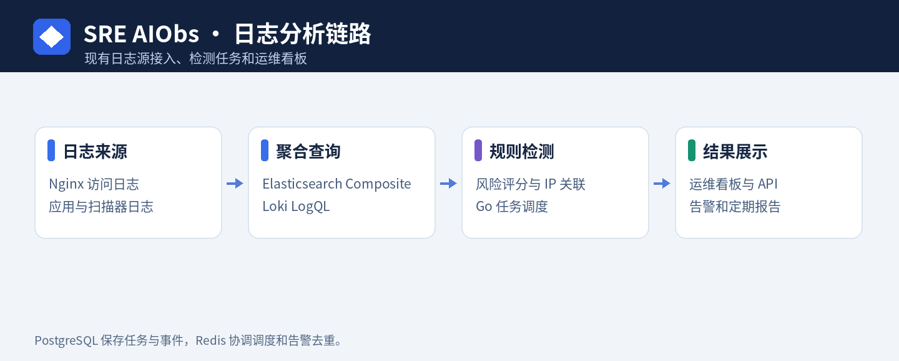
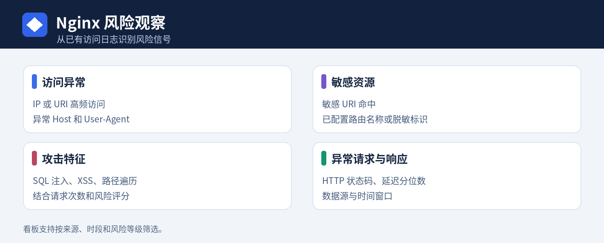
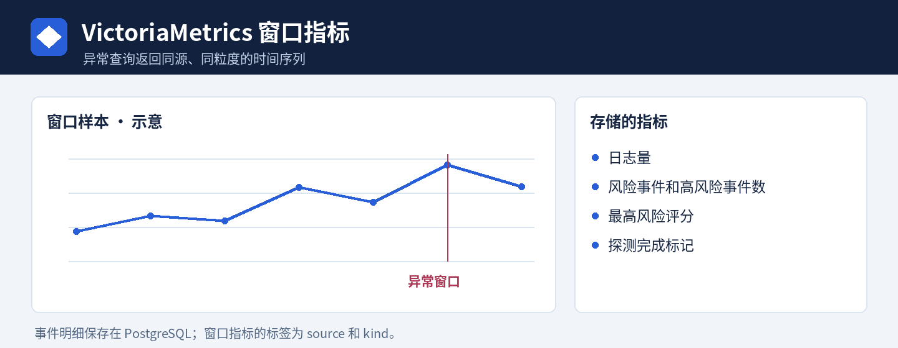
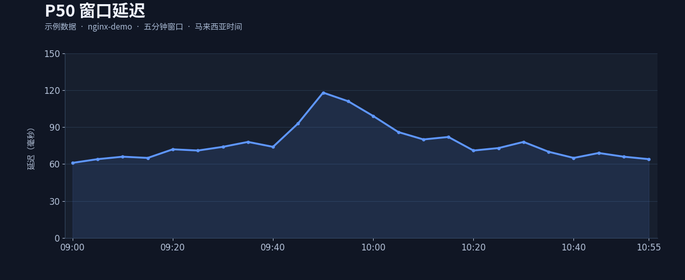
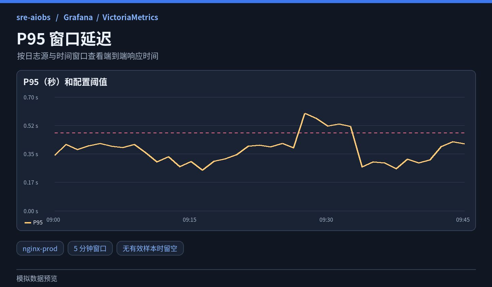
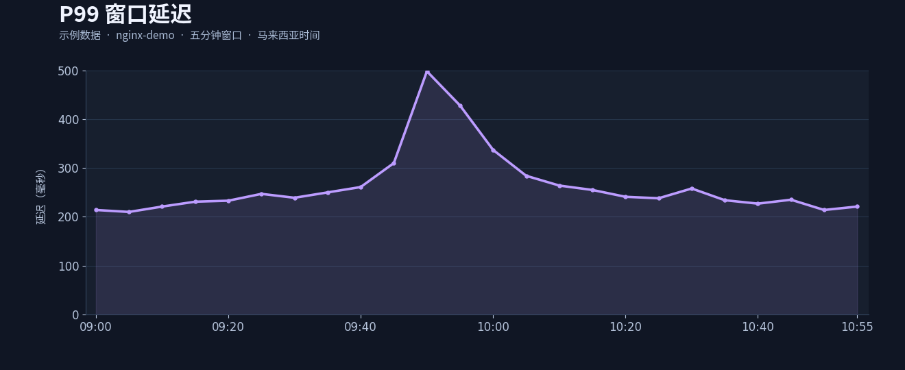
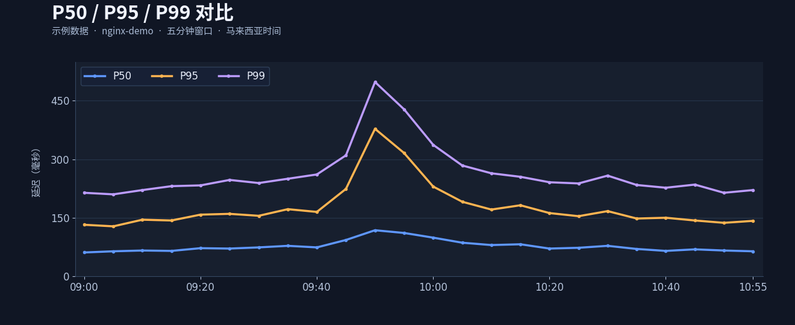
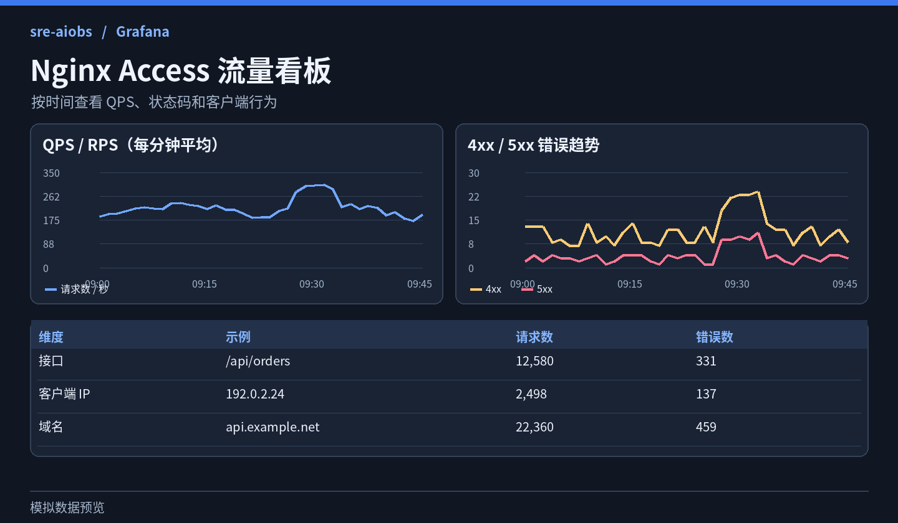
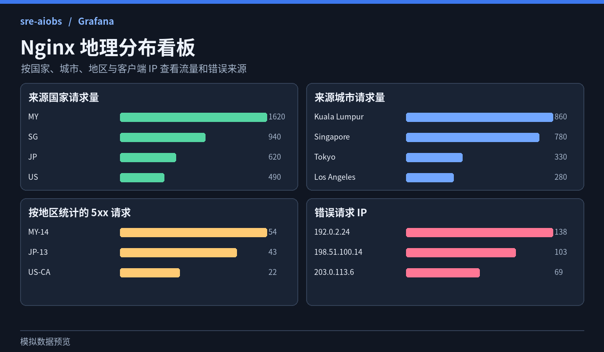

# sre-aiobs

Go 编写的 Nginx 日志安全检测和告警服务。读取现有 Elasticsearch 和 Loki，通过聚合结果检测访问异常，使用 PostgreSQL 保存任务与风险事件，通过 Redis 协调任务、AI 调用限额和 Telegram 冷却。


[更新与配置说明](docs/update-and-configuration.md)记录 Go 升级、登录双重验证、数据源接入、路由和巡检报告的配置方法。

## 界面预览

[功能预览文档](docs/preview/README.md)汇总运维、Grafana、Kibana 和采集链路。

打开仓库里的 [离线演示](docs/preview/index.html)，在 GitHub 文件页点击 **Download raw file**，下载后双击 `index.html`。演示包含安全概览、Nginx 风险接口、漏洞检测、数据源列表和告警设置，使用模拟数据，支持筛选和查看详情。

### 功能示意图






<details>
<summary>查看巡检、异常追踪、VictoriaMetrics 与部署示意图</summary>





</details>

## 部署方式

[单机快速部署](docs/quickstart.md)包含启动命令、登录入口、日志验证和多机采集步骤。

| 环境 | 部署入口 |
| --- | --- |
| 单机打包部署 | [单机部署包](docs/deployment.md#单机部署包)，解压后运行 `./deploy/single-node/start.sh` |
| 内网服务器或单机 | [Docker Compose](docs/deployment.md#docker-compose)，包含 PostgreSQL、Redis、数据库迁移和 Go 服务 |
| Kubernetes | [Kubernetes](docs/deployment.md#kubernetes)，使用集群可访问的 PostgreSQL、Redis、Elasticsearch 或 Loki |

启用真实数据源后，使用「日志数据源」中的「检查」验证连接。默认 Compose 看板地址为 `http://127.0.0.1:8080/`，用户名填 `operator`，密码为 `DASHBOARD_PASSWORD`。

## 项目结构

| 目录 | 职责 |
| --- | --- |
| `cmd/sre-aiobs` | 服务启动、迁移、补偿、健康与指标接口 |
| `internal/platform` | 聚合窗口、事件、报告及服务接口 |
| `internal/config` | YAML 读取及验证 |
| `internal/source` | Elasticsearch Composite 和 Loki LogQL |
| `internal/detect` | 规则、历史基线、风险评分、按 IP 关联 |
| `internal/ai` | 上游调用、脱敏、JSON 输出校验、限流和熔断 |
| `internal/store` | PostgreSQL 状态和 Redis 协调 |
| `internal/notify` | Slack、Telegram 和 AWS SES |
| `internal/worker` | 调度与窗口处理 |
| `migrations`、`deploy` | 数据库、Kubernetes 与 Grafana |
| `testdata`、`tests` | 模拟日志和 Compose 集成测试 |

## 本地验证

[巡检整合交付记录](docs/inspection-integration.md)包含现有能力、配置示例、API、迁移和未完成范围。

[安全审查](docs/security-review.md)记录已修复问题、部署风险和审查范围。

```sh
go test ./...
go vet ./...
./tests/compose.sh
# 验证 VictoriaMetrics 真实写入和查询
TEST_VICTORIAMETRICS=1 ./tests/compose.sh
```

Compose 测试用独立的随机项目名，验证真实 Elasticsearch 日志聚合、PostgreSQL 持久化、Redis 锁、补偿重放幂等、风险事件、就绪探针和指标。测试依赖 Docker Compose v2、curl、OpenSSL、Python 3 和 GNU date。Loki 有 HTTP 契约测试，外部 AI 和通知渠道需用已获授权的测试账户验证。

配置与部署见 [部署手册](docs/deployment.md) 和 [示例配置](config.example.yaml)。

## Web 运维看板

[启用 Google Authenticator 动态验证码](docs/quickstart.md#可选启用登录双重验证)。

通过环境变量或 Kubernetes Secret 注入 `DASHBOARD_PASSWORD`，启动服务后访问根路径 `/`。浏览器登录框的用户名可填 `operator`，密码为注入值。默认 Compose 地址为 `http://127.0.0.1:8080/`。看板支持按数据源、时间范围和风险评分查询，包含请求趋势、规则分布、任务记录、风险详情及已保存的 AI 分析。

看板使用五分钟或小时任务的已保存窗口，同一视图使用单一粒度，避免重复统计。未配置密码时看板与数据 API 返回 503。生产环境应通过内网 HTTPS 入口访问。现有健康检查和指标路径独立于看板认证。

### 告警设置与 Slack

运维看板的「告警设置」可调整实时告警最低风险评分、冷却时间，以及 Slack、Telegram 和 SES 邮件渠道开关。通过环境变量或 Kubernetes Secret 注入 `ALERT_SETTINGS_PASSWORD`，保存设置时输入此独立管理密码。设置保存在 PostgreSQL，后续告警任务读取新设置。

在 [Slack 应用设置](https://api.slack.com/apps) 中为目标频道创建 Incoming Webhook，将完整地址通过 `SLACK_WEBHOOK_URL` 注入服务。Slack 与 Telegram 使用独立冷却和投递记录。没有配置 Webhook 时，Slack 开关不会产生投递。

在 [Telegram BotFather](https://t.me/BotFather) 输入 `/newbot` 创建机器人。将机器人加入目标群组或频道并授予发送权限，通过 `TELEGRAM_BOT_TOKEN` 注入 Token，在 YAML 中填写目标会话 ID `telegram_chat`。

已有数据库升级时须运行迁移。Compose 迁移服务和 Kubernetes 迁移 Job 会按顺序应用 `/migrations`。手动部署可运行 `sre-aiobs -migrate ./migrations`，然后启动新版本。

### 应用后端日志

应用日志可与 Nginx 日志并行接入。已有结构化字段可用于识别严重日志、错误激增、未处理异常和下游依赖故障。字段映射及阈值见 [部署手册](docs/deployment.md#应用后端日志探测)。

后端日志事件支持独立查询 `GET /api/backend-logs?source=orders-backend&hours=24&score=80`，沿用看板登录保护及筛选参数。返回符合条件的事件总数 `total`、各规则计数 `counts`、最近 100 条 `events`、查询时间 `updated` 和聚合粒度 `kind`。应用运行事件仍可在看板「风险事件」中查看明细及已有 AI 分析。

### 数据源诊断与 Nginx 风险接口

- `GET /api/sources` 列出当前生效的日志源名称、类型、环境和后端字段映射状态。
- `POST /api/sources/{name}/check` 使用已配置的数据源查询最近一分钟聚合量。请求需带 `X-SRE-AIObs-Check: 1`，结果区分成功、超时、权限不足等状态。看板「数据源」里的「检查」按钮直接调用此接口。
- `GET /api/nginx-risk-routes` 查询危险 URI 命中明细，支持与 `/api/backend-logs` 相同的 `source`、`hours` 和 `score` 筛选。低于 65 分的高频 URI 在「所有风险」下查看。

在看板进入「路由配置」，选择 Nginx 数据源，填写路由名和 Go 正则，调整顺序后保存。比如将 `^/api/orders/[0-9]+$` 显示为 `/api/orders/:id`。修改使用 `ALERT_SETTINGS_PASSWORD`，可随时恢复 YAML 默认规则。

路由规则按配置顺序取首个匹配项。无匹配时展示路径哈希，接口响应不包含原始 URI、查询串和路径参数。旧事件会沿用当时已保存的目标标识。

### 漏洞检测邮件

看板「漏洞检测」及 `GET /api/vulnerabilities` 汇总可信扫描源的 CVE 发现。配置扫描日志字段与 AWS SES 收件人后，漏洞发现随小时报告和日报发送。[接入说明](docs/deployment.md#漏洞发现与定期邮件)

### Nginx 安全巡检

「Nginx 安全巡检」汇总敏感资源、请求异常、认证失败、限流、WAF 分类、旧版 TLS 和上游故障等信号。各类别根据日志字段映射启用。[字段映射与规则说明](docs/deployment.md#nginx-安全巡检)

### VictoriaMetrics 窗口指标

可选接入 VictoriaMetrics 保存每个探测窗口的日志量、风险事件数、最高评分和探测完成标记。看板异常详情、Slack、Telegram 和邮件报告可提供同源、同粒度的时间序列查询链接。[部署方式](docs/deployment.md#victoriametrics)

### Grafana 延迟与异常仪表盘

提供 P50、P95、P99 独立图和对比图，以及 P95 越限、风险事件和最高风险评分图。支持按日志源和窗口粒度筛选。[导入或启动 Grafana](docs/deployment.md#grafana-延迟与异常图)

<details>
<summary>查看 P50、P95、P99 和异常图预览（示例数据）</summary>










</details>

### Nginx Access 日志看板与 Filebeat

新装环境运行 `./deploy/single-node/start.sh --with-nginx-collector`，可启动带 Elasticsearch 的完整服务栈和同机 Nginx 采集。Grafana 自动配置「Nginx Access 日志看板」，包含 QPS、状态码、延迟、域名、服务、流量、风险排查、客户端 IP 和地区分布。多台 Nginx 通过私网 HTTPS 接入，使用 Ansible 分批部署采集端。[启动命令、索引映射和批量采集说明](docs/deployment.md#elasticsearch-与-nginx-批量采集)



「Nginx 地理分布看板」按国家、地区和城市显示请求量、错误趋势及高频 IP，便于定位异常流量的来源。[查看看板配置](deploy/grafana/nginx-geo-dashboard.json)



### 完整 ELK 部署

用 `./deploy/single-node/start.sh --with-elk --with-nginx-collector` 启动 Elasticsearch、Logstash、Kibana、Filebeat 和现有运维组件。Kibana 预置 Nginx、应用日志、漏洞发现三个数据视图。Kibana 和 Grafana 都会自动加载 Nginx 流量与地理分布看板。[ELK 启动与接入说明](docs/deployment.md#完整-elk-单机部署)
