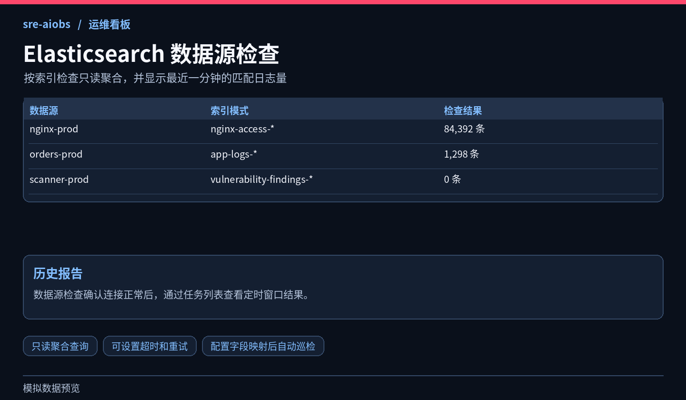
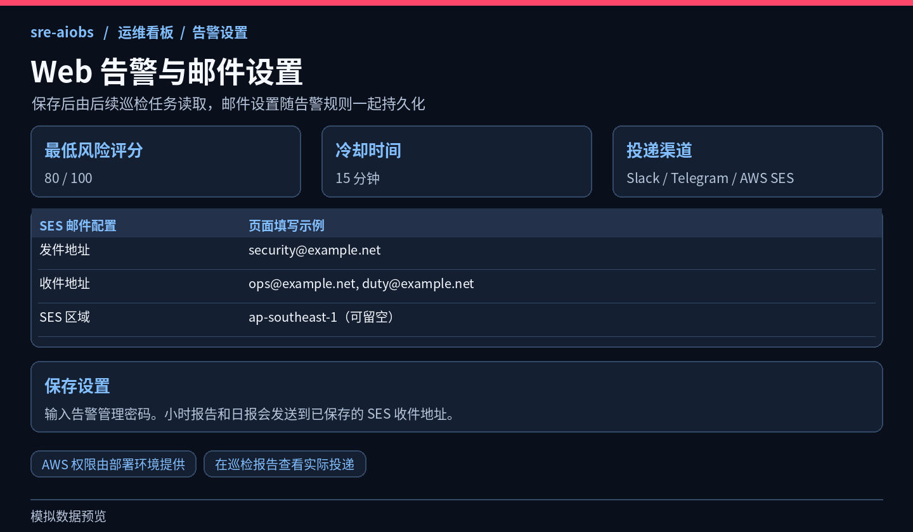
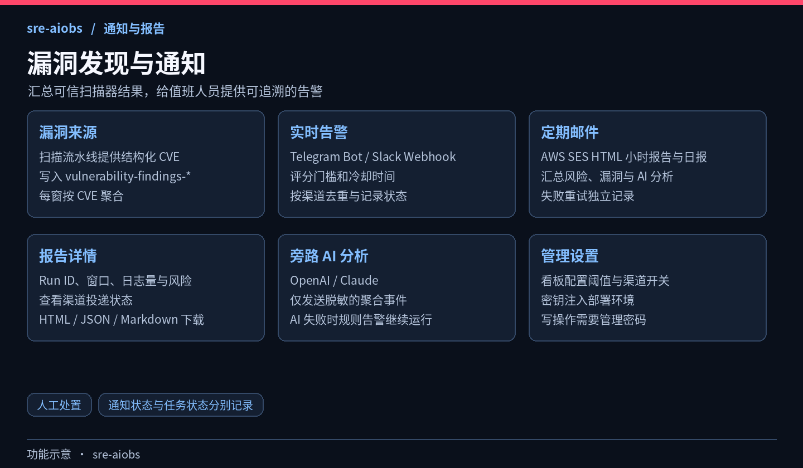
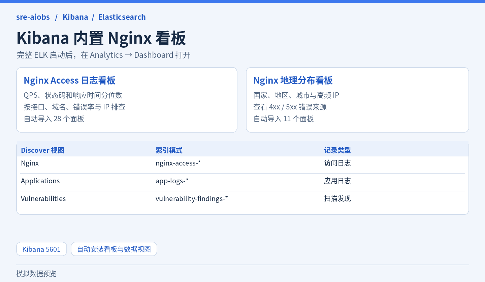
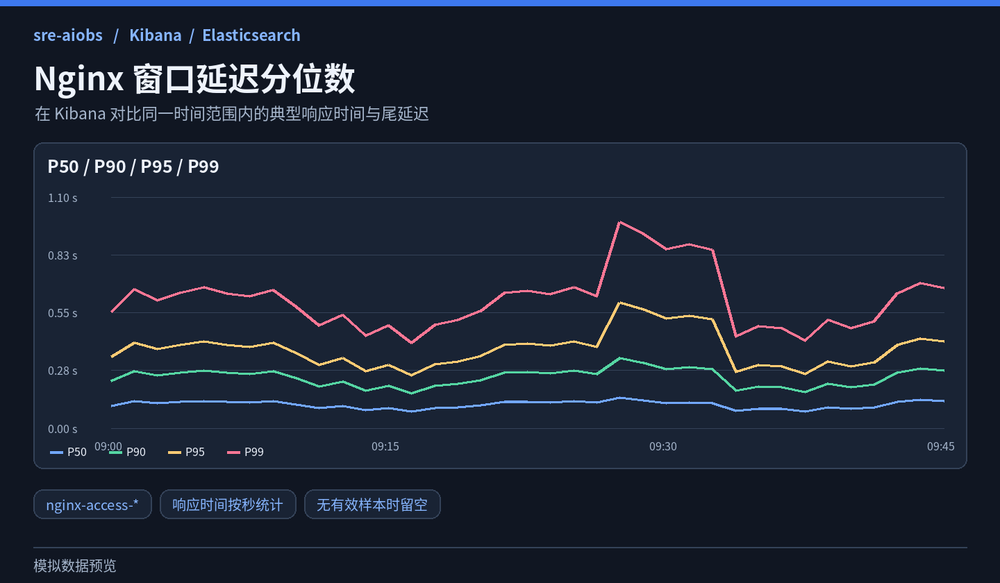
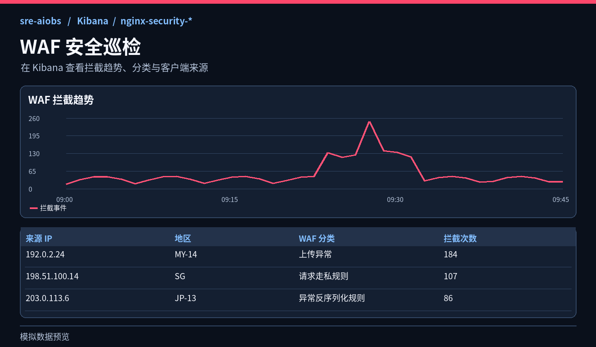

# sre-aiobs

基于 ELK 的 Nginx 安全巡检与告警平台。Filebeat 与 Logstash 采集日志，Go 服务通过 Elasticsearch 聚合查询分析风险，Kibana 展示请求量、延迟和地理分布。PostgreSQL 保存任务、报告和审计，Redis 协调登录会话、任务及告警去重。

[中文更新与配置说明](docs/update-and-configuration.md) · [从零搭建 AIOps 与全部中间件](docs/full-setup.md) · [快速部署](docs/quickstart.md) · [功能预览](docs/preview/README.md) · [离线演示](docs/preview/index.html)

## 功能预览

图片为界面示意或模拟数据。操作步骤见 [Web 配置手册](docs/web-operations.md)。

### AIOps Web 登录

[打开登录界面离线预览](docs/preview/login.html) · [如何启用独立登录页](docs/web-operations.md#web-登录)


<details>
<summary>展开运维看板、Nginx 安全巡检与告警设置</summary>









</details>

<details>
<summary>展开 Kibana 流量、延迟、GeoIP 与 WAF 看板</summary>









</details>

<details>
<summary>展开 ELK 架构、单机部署与批量采集</summary>


</details>

## 部署

安装 Docker、Compose v2 和 OpenSSL。在项目目录运行以下命令。采集目录和文件名按实际 Nginx JSON 日志修改。

```bash
NGINX_LOG_DIR=/var/log/nginx NGINX_LOG_GLOB=sre-aiobs.jsonl \
  ./deploy/single-node/start.sh --with-elk --with-nginx-collector
```

| 入口 | 本机地址 | 登录 |
| --- | --- | --- |
| 运维看板 | `http://127.0.0.1:8080` | `operator`，密码见 `.env` 的 `DASHBOARD_PASSWORD` |
| Kibana | `http://127.0.0.1:5601` | 初始账号 `elastic`，密码见 `.env` 的 `ELASTIC_PASSWORD` |

Kibana 在首次启动时导入 Nginx Access、地理分布和安全巡检看板。已有 Elasticsearch 时，可通过 [部署手册](docs/deployment.md#日志源) 配置只读账号和索引。多机采集先启动 AIOps，再从「采集部署」配置并批量安装 Filebeat，参见 [采集部署步骤](docs/full-setup.md#远程-nginx-批量采集)。AWS、巡检阈值、AI、邮件和采集的界面配置见 [配置与加密](docs/web-runtime-settings.md)。已有配置升级请先检查 [迁移步骤](docs/update-and-configuration.md#部署升级)。

## Web 管理

[Web 登录、Nginx 安全巡检和告警配置](docs/web-operations.md)包含实际入口、配置项和操作步骤。

## 巡检与报告

[AWS 云端巡检配置](docs/aws-inspection.md)介绍如何通过 Access Key 或 IAM Role 接入 CloudWatch，只读检查异常告警。

- **Nginx 安全巡检**支持 IP、URI、Host、User-Agent、状态码、GeoIP 和历史基线。事件详情可打开对应 Run ID 的报告。
- **应用日志与漏洞发现**按 Elasticsearch 索引配置。运行异常按级别、故障分类和业务错误码聚合，可信扫描器的 CVE 可进入定期报告。
- **接口性能**在 Kibana 查看 QPS、P50／P90／P95／P99 和错误率。运维报告也展示有样本的窗口延迟。
- **历史报告与通知**提供 HTML、JSON、Markdown 导出，以及 Telegram、Slack 和 AWS SES。双重验证和 OpenAI／Claude 可按需启用。

[四类索引与安全巡检](docs/elasticsearch-indexes.md) · [巡检 API 与迁移详情](docs/inspection-integration.md) · [安全审查](docs/security-review.md)

## 验证

```bash
go build ./...
go test ./...
go vet ./...
./tests/compose.sh
```

Compose 集成测试用独立项目验证 Elasticsearch 日志聚合和运维 API，需要本地 Docker。
