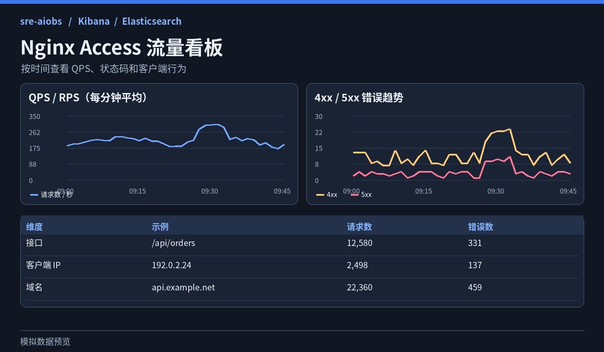
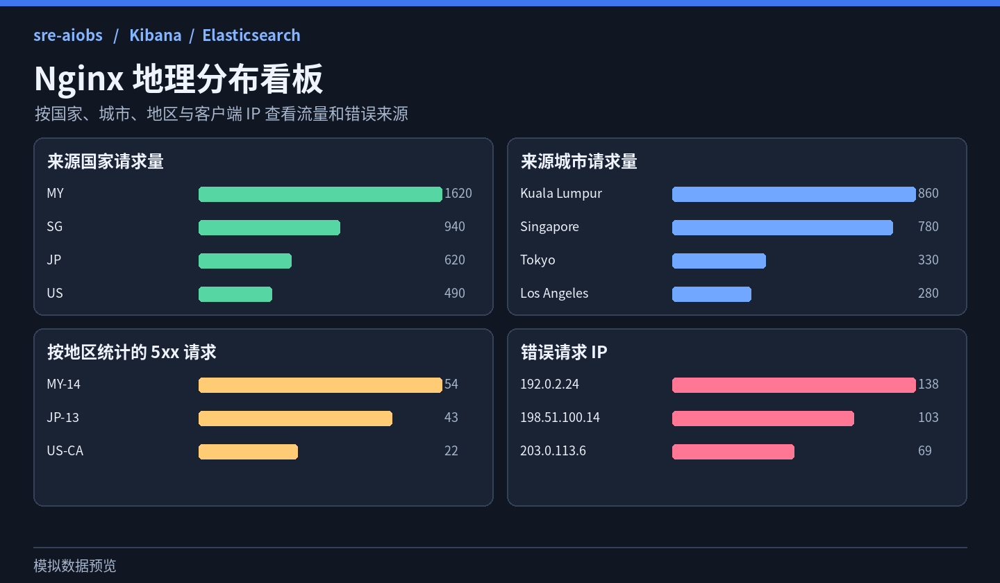

# sre-aiobs

基于 ELK 的 Nginx 安全巡检与告警平台。Filebeat 与 Logstash 采集日志，Go 服务通过 Elasticsearch 聚合查询分析风险，Kibana 展示请求量、延迟和地理分布。PostgreSQL 保存任务、报告和审计，Redis 协调登录会话、任务及告警去重。

[中文更新与配置说明](docs/update-and-configuration.md) · [快速部署](docs/quickstart.md) · [功能预览](docs/preview/README.md) · [离线演示](docs/preview/index.html)

## 功能示意图

以下图片用示意或模拟数据展示功能。







在 [完整图集](docs/preview/README.md) 还可查看双重验证登录、巡检报告、批量采集和部署示意。

## 部署

安装 Docker、Compose v2 和 OpenSSL。在项目目录运行以下命令。采集目录和文件名按实际 Nginx JSON 日志修改。

```bash
NGINX_LOG_DIR=/var/log/nginx NGINX_LOG_GLOB=sre-aiobs.jsonl \
  ./deploy/single-node/start.sh --with-elk --with-nginx-collector
```

| 入口 | 本机地址 | 登录 |
| --- | --- | --- |
| 运维看板 | `http://127.0.0.1:8080` | `operator`，密码见 `.env` 的 `DASHBOARD_PASSWORD` |
| Kibana | `http://127.0.0.1:5601` | 初始账号 `elastic`，密码见 `.env` 的 `ELASTIC_PASSWORD` |

Kibana 在首次启动时导入 Nginx Access 和地理分布看板。已有 Elasticsearch 时，可通过 [部署手册](docs/deployment.md#日志源) 配置只读账号和索引。多机采集通过 [Ansible 与内网 HTTPS 网关](docs/deployment.md#elasticsearch-与-nginx-批量采集) 接入。已有配置升级请先检查 [迁移步骤](docs/update-and-configuration.md#部署升级)。

## 巡检与报告

- **Nginx 安全巡检**支持 IP、URI、Host、User-Agent、状态码、GeoIP 和历史基线。事件详情可打开对应 Run ID 的报告。
- **应用日志与漏洞发现**按 Elasticsearch 索引配置。运行异常按级别、故障分类和业务错误码聚合，可信扫描器的 CVE 可进入定期报告。
- **接口性能**在 Kibana 查看 QPS、P50／P90／P95／P99 和错误率。运维报告也展示有样本的窗口延迟。
- **历史报告与通知**提供 HTML、JSON、Markdown 导出，以及 Telegram、Slack 和 AWS SES。双重验证和 OpenAI／Claude 可按需启用。

[巡检 API 与迁移详情](docs/inspection-integration.md) · [安全审查](docs/security-review.md)

## 验证

```bash
go build ./...
go test ./...
go vet ./...
./tests/compose.sh
```

Compose 集成测试用独立项目验证 Elasticsearch 日志聚合和运维 API，需要本地 Docker。
