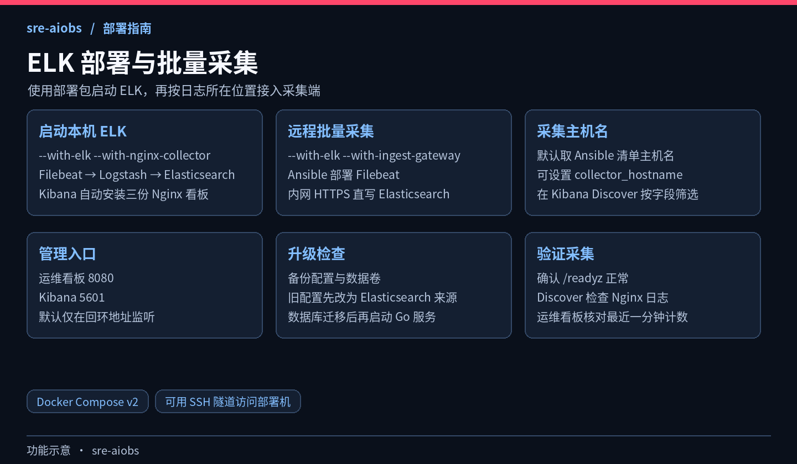
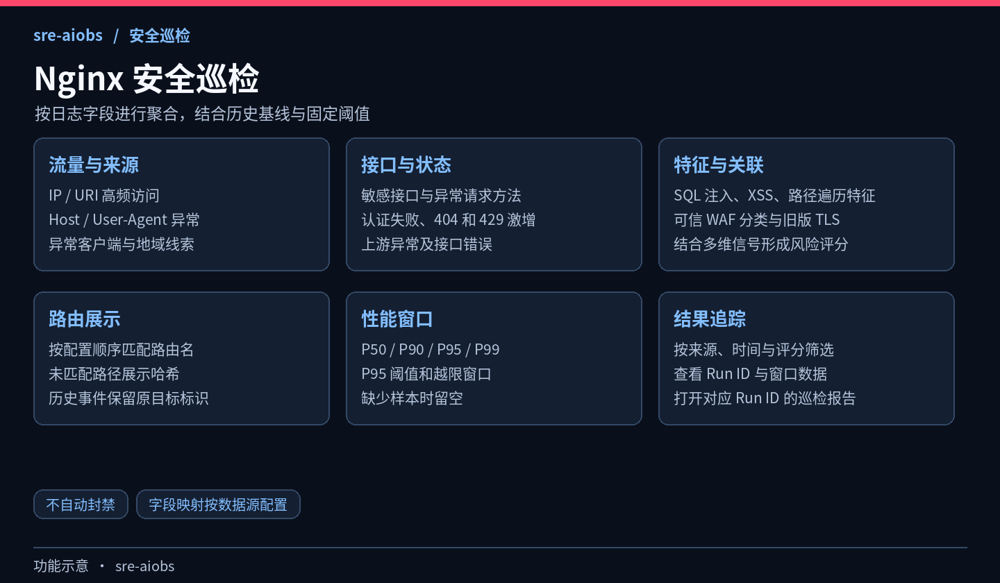
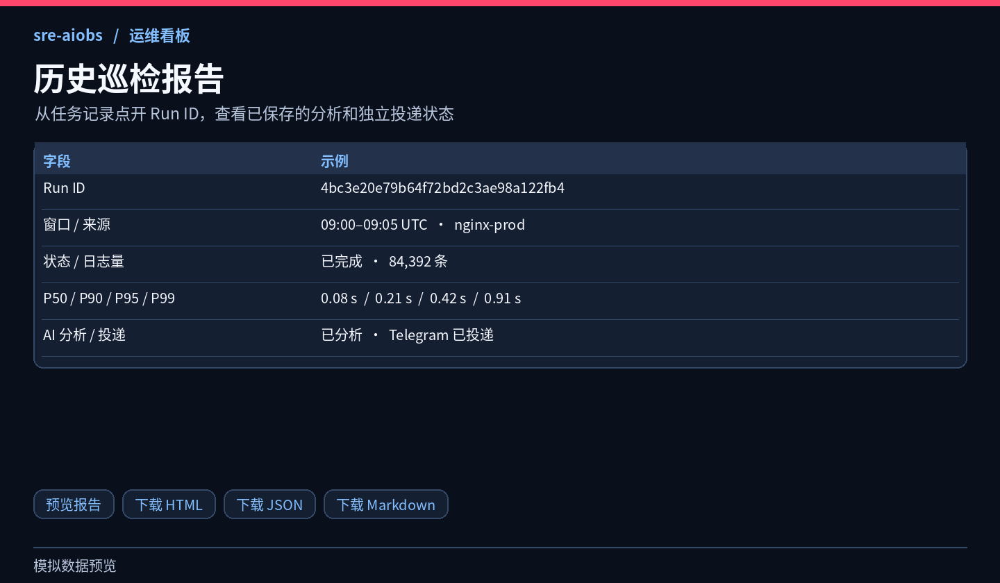

# ELK 与运维看板预览

[离线演示](index.html)可下载后直接在浏览器打开，使用模拟事件。下方图片是功能示意或模拟指标。接入真实数据的步骤见[快速部署](../quickstart.md)。

## ELK 日志链路

## Kibana 看板

完整 ELK 首次启动后，在 **Analytics → Dashboard** 打开内置的 Nginx Access、地理分布和安全巡检看板。Discover 中可按 `collector_hostname` 筛选远程采集机。

| Data View | 索引模式 | 记录类型 |
| --- | --- | --- |
| Nginx | `nginx-access-*` | Nginx 访问日志 |
| Nginx Security | `nginx-security-*` | WAF 安全日志 |
| Applications | `app-logs-*` | 应用日志 |
| Vulnerabilities | `vulnerability-findings-*` | 扫描发现记录 |

[完整索引和安全巡检配置](../elasticsearch-indexes.md)

## 自动巡检与运维

