# sre-aiobs 功能预览

将 [离线演示 HTML](index.html) 下载后用浏览器打开，即可体验风险筛选、事件详情、数据源列表和告警设置。演示使用模拟数据。下方图片为功能示意或模拟指标预览。要查看自己的日志，请按 [快速部署](../quickstart.md) 启动服务。

## 运维看板

| 功能 | 在页面里看什么 |
| --- | --- |
| 安全概览 | 请求量、风险事件、异常来源和窗口概况 |
| Nginx 风险接口 | 按来源、时间和评分查找风险接口，查看巡检规则及命中次数 |
| 漏洞检测 | 按数据源查看聚合后的 CVE；由现有扫描器提供结果 |
| 日志数据源 | 检查六类数据源的连接；日志源额外显示最近一分钟匹配条数 |
| 历史报告 | 从任务记录打开 HTML 预览并下载 HTML、JSON 或 Markdown |
| 登录 | 可选启用 Google Authenticator 六位动态码 |
| 告警设置 | 管理告警阈值、冷却时间和投递开关。Slack、Telegram、SES 凭据在部署端注入 |

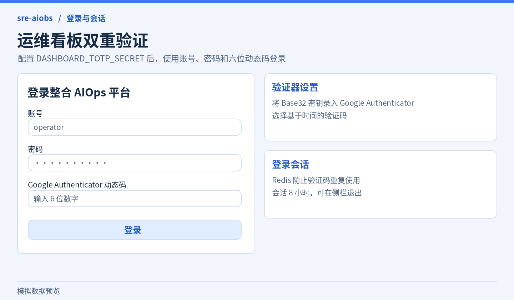

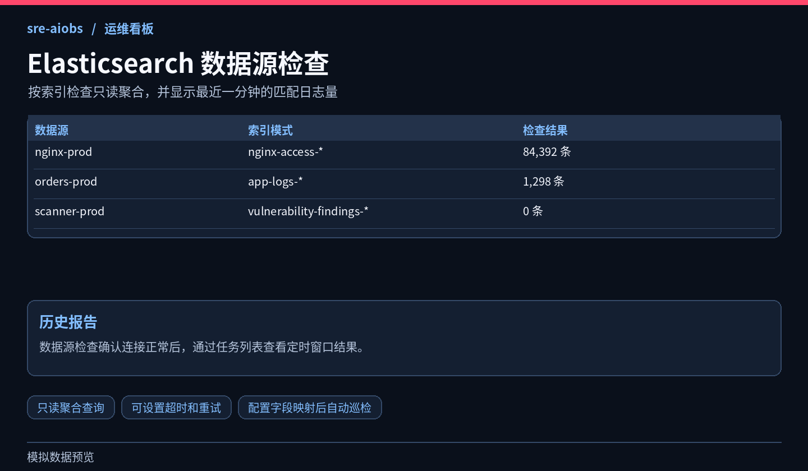

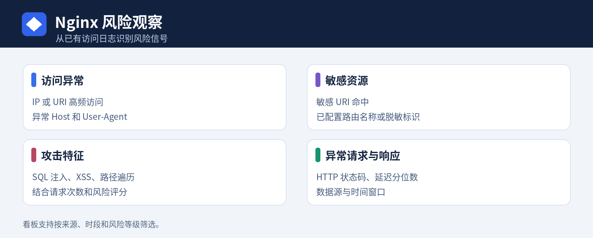

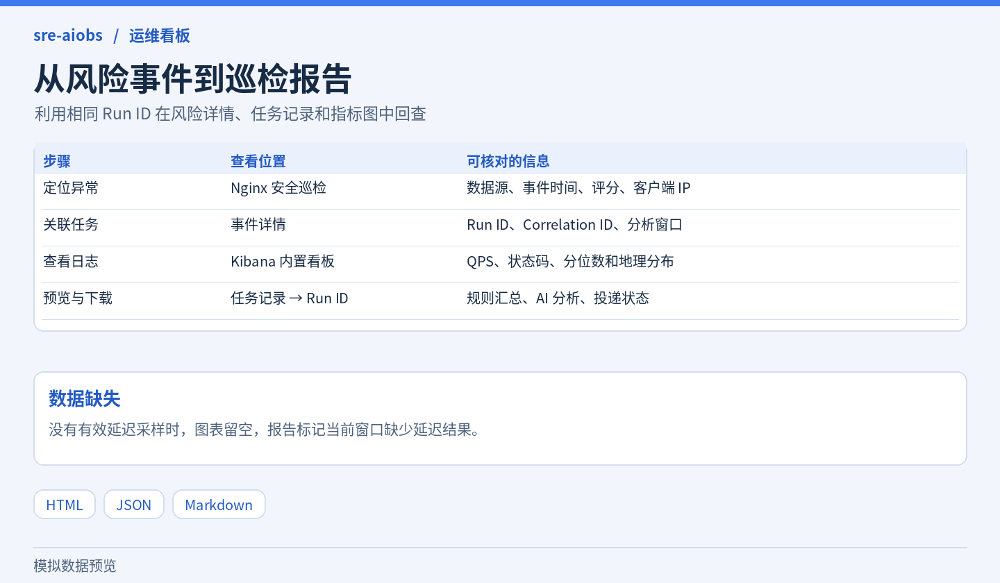

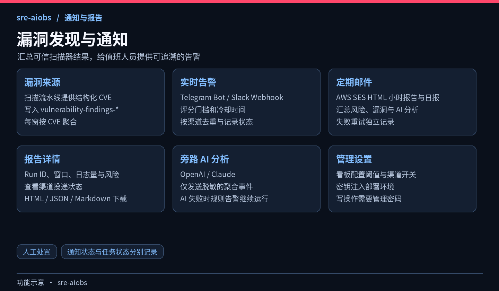

## Grafana

| 看板 | 内容 |
| --- | --- |
| Nginx Access | QPS、状态码、P50／P95／P99、慢接口、出错接口、域名、服务和客户端 IP |
| Nginx 地理分布 | 国家、地区和城市排行，4xx／5xx 分布和高频 IP 错误率 |
| sre-aiobs 巡检指标 | VictoriaMetrics 中的窗口流量、P50／P90／P95／P99、延迟阈值和风险事件 |

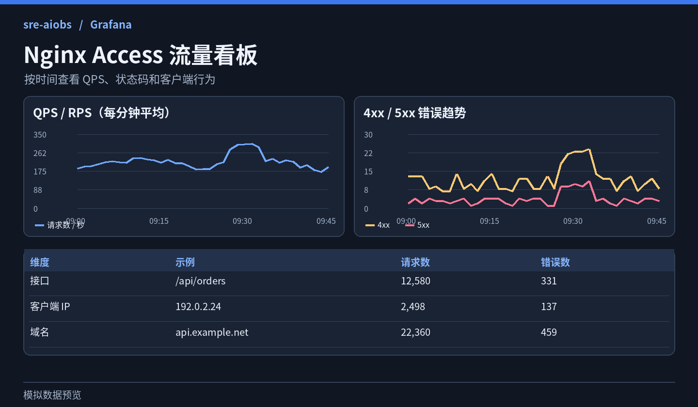

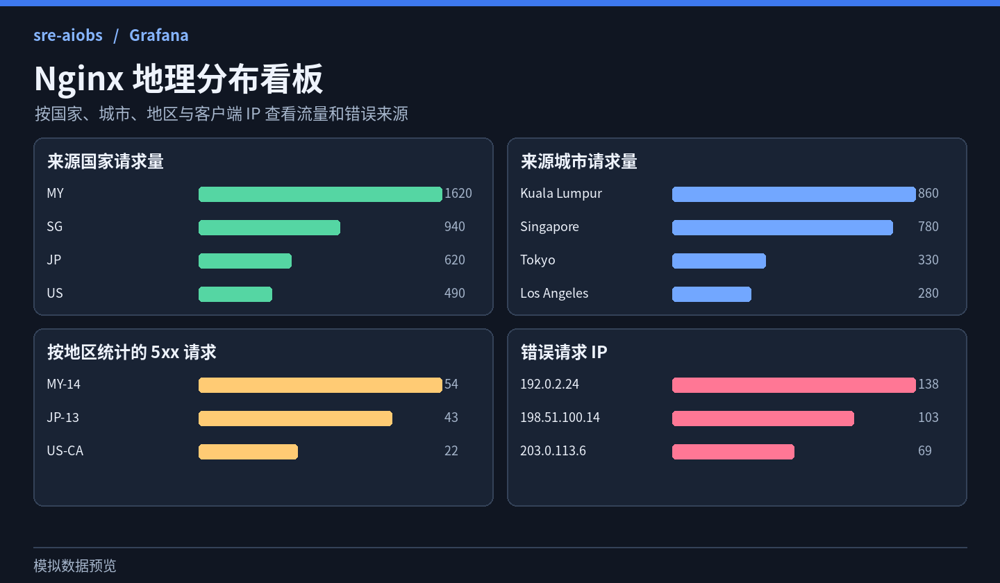

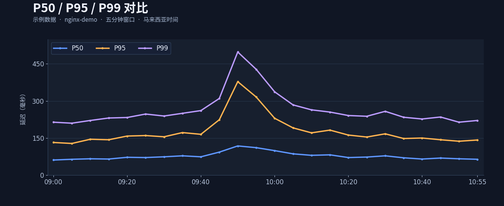

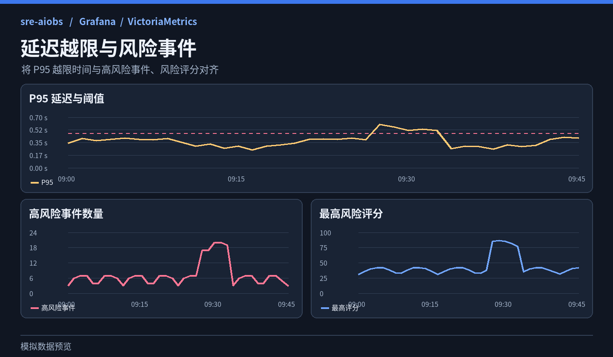

单图预览 · [P50](images/grafana-p50.png) · [P90](images/grafana-p90.png) · [P95](images/grafana-p95.png) · [P99](images/grafana-p99.png)

## Kibana 与采集链路

完整 ELK 首次启动后，在 Kibana **Analytics → Dashboard** 可以直接打开两份内置看板。

- [Nginx Access 日志看板](../../deploy/elk/dashboards/sre-aiobs-nginx-access.ndjson)包含每分钟 QPS、P50／P95／P99、状态码、流量、接口延迟和错误率。
- [Nginx 地理分布看板](../../deploy/elk/dashboards/sre-aiobs-nginx-geo.ndjson)包含国家、地区、城市与高频 IP，按来源查看流量和错误数。

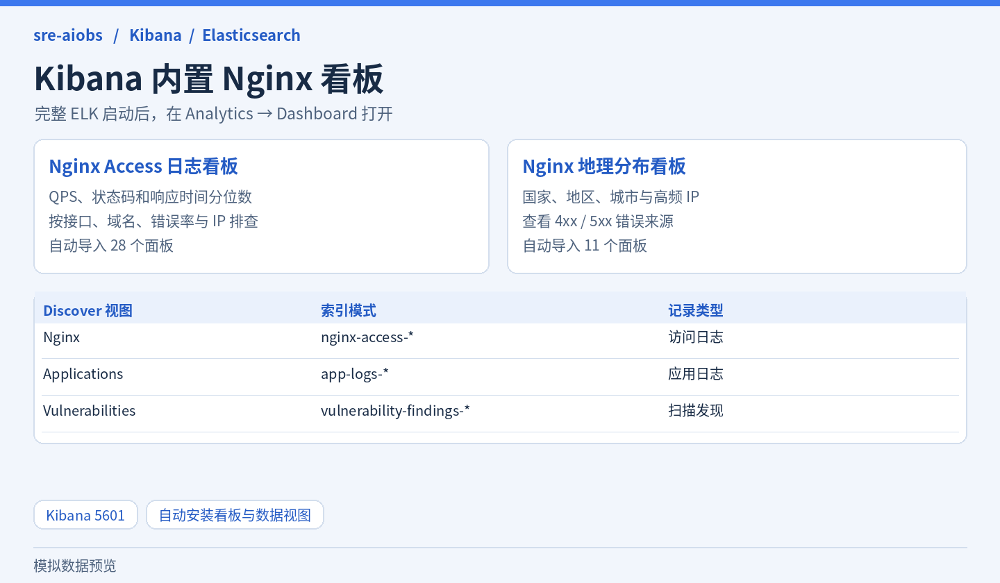

Kibana Discover 预置以下三个 Data View，可按时间范围和字段筛选：

| Data View | Elasticsearch 索引 | 来源 |
| --- | --- | --- |
| Nginx | `nginx-access-*` | 本机 Filebeat 经 Logstash，或远程采集端经 HTTPS 网关 |
| Applications | `app-logs-*` | 已有应用日志链路 |
| Vulnerabilities | `vulnerability-findings-*` | 已有扫描器或流水线产出的发现记录 |

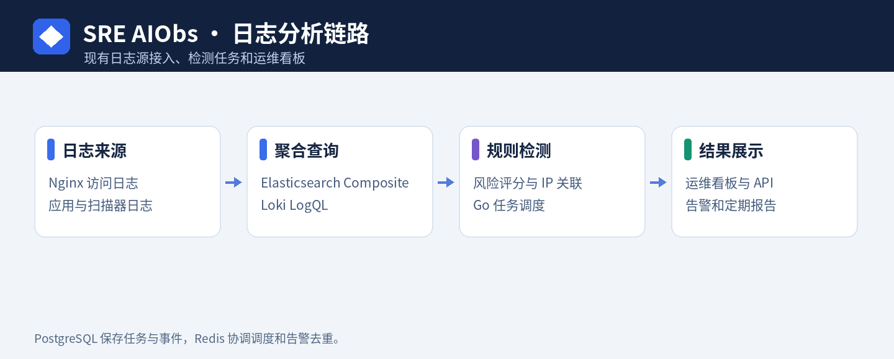

其余示意图 · [巡检类别](images/nginx-inspection.png) · [VictoriaMetrics 异常查询](images/victoriametrics.png) · [部署结构](images/deployment.png)
