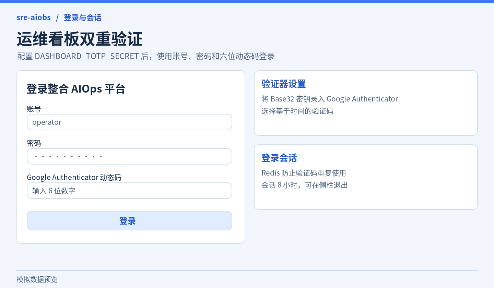
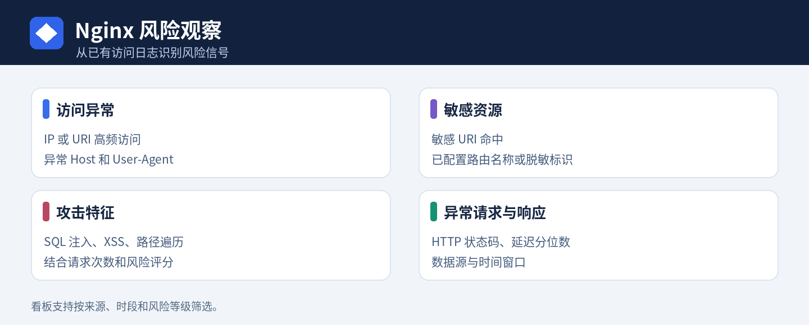
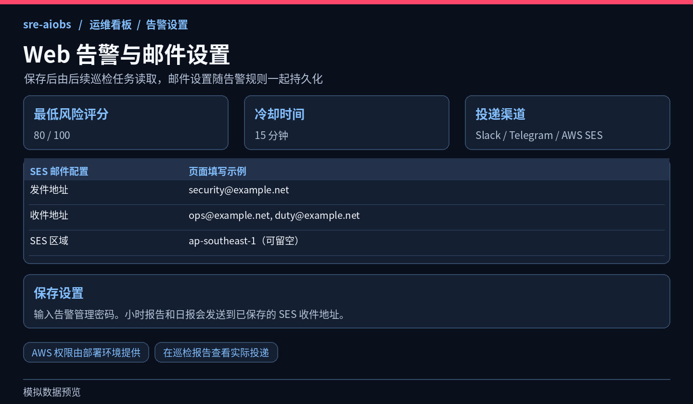

# Web 登录、Nginx 巡检与告警配置

## Web 登录

打开运维看板 `http://127.0.0.1:8080/`，使用 `operator` 和部署机 `.env` 的 `DASHBOARD_PASSWORD`。完整 ELK 启动脚本首次生成密码。远程访问使用受控 HTTPS 入口或按 [快速部署](quickstart.md#3-打开界面并确认有数据) 建立 SSH 隧道。

启用 Google Authenticator 时，用 `openssl rand 20 | base32` 生成密钥，在验证器中选择基于时间的动态码，同时将密钥写入部署机 `.env` 的 `DASHBOARD_TOTP_SECRET`。按原启动参数更新容器后，登录页会要求账号、密码和六位动态码。Kubernetes 部署通过 `sre-aiobs-env` Secret 注入相同变量。启用动态码后用 HTTPS 入口访问运维看板。[完整绑定步骤](quickstart.md#可选启用登录双重验证)

启用动态码后，登录页路径为 `/login`；动态码未配置时，访问首页会出现浏览器 Basic Auth 登录弹窗。[打开 AIOps 登录界面离线预览](preview/login.html)

## Nginx 安全巡检

1. 将 Nginx 访问日志写入 `nginx-access-*`。已有 WAF 采集器时，可将结构化安全日志写入独立的 `nginx-security-*`。
2. 在 `config.yaml` 的 `sources` 核对索引模式和时间字段。访问源映射 URI、IP、状态和响应时间。安全源映射 `waf_action`、`waf_category`，需要 GeoIP 时映射国家和地区字段。
3. 登录后在「日志数据源」点击「检查」，确认索引可查询。在「Nginx 安全巡检」结合顶部的数据源、时间范围和风险评分查看事件，点击「详情」追踪对应 Run ID。

自动巡检由后台任务执行。阈值通过 `config.yaml` 的 `rules` 管理，例如 `ip`、`uri`、`errors` 和 `nginx_burst`。[索引和字段映射](elasticsearch-indexes.md)

## 报警与通知

Web 菜单名称是「告警设置」。按下表配置要用的渠道。

| 渠道 | 部署配置 | 出现在哪里 |
| --- | --- | --- |
| Slack | `.env` 注入 `SLACK_WEBHOOK_URL` | 分钟任务的实时告警 |
| Telegram | `.env` 注入 `TELEGRAM_BOT_TOKEN`，`config.yaml` 填 `telegram_chat` | 分钟任务的实时告警 |
| AWS SES 邮件 | Web 填发件地址、收件地址和可选 SES 区域，部署环境提供 SES 发送权限 | 小时报告和日报 |

修改环境变量后用原启动选项更新容器。邮件地址和区域保存在 PostgreSQL，Web 保存后后续任务直接读取。收件地址可每行一个或用逗号分隔，最多 50 个；区域留空时由 AWS SDK 从部署环境解析。升级时请把原 YAML 的邮件地址录入 Web，旧 YAML 地址会被忽略。登录 Web 后打开「告警设置」，选择渠道、最低风险评分和冷却时间，输入 `ALERT_SETTINGS_PASSWORD` 保存。默认最低评分 80，冷却 15 分钟。评分和冷却适用于实时告警，邮件报告单独启用。页面只显示配置是否齐备，Nginx 访问和 WAF 来源发送带风险评分、来源 IP 和地区的安全巡检 HTML；扫描来源发送包含 CVE 编号和记录次数的漏洞巡检 HTML。邮件按数据源和任务窗口发送，正文带 Run ID。实际投递结果在「任务记录 → Run ID → 投递状态」查看。SES 还需确保发件身份已经验证。[详细告警配置](deployment.md#ai-与通知)

